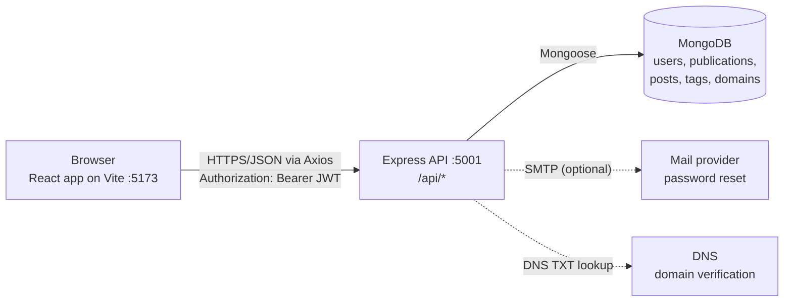

# DevPress

DevPress is a publishing platform for developers. A writer creates an account, starts one or more **publications** (each with its own name, address, appearance and public website), and writes technical articles in Markdown inside them, either in a normal document editor or on an animated **typewriter** that types the article onto paper as you write.

It is an individual full-stack project built with the MERN stack (MongoDB, Express, React, Node.js). It is inspired by Hashnode and is not affiliated with Hashnode.

> **Status:** in active development, run locally. Not deployed. See [Limitations and future improvements](#11-limitations-and-future-improvements).

## Contents

1. [Project overview](#1-project-overview)
2. [Features and current implementation](#2-features-and-current-implementation)
3. [Technology stack](#3-technology-stack)
4. [System architecture](#4-system-architecture)
5. [Prerequisites and installation](#5-prerequisites-and-installation)
6. [Running DevPress locally](#6-running-devpress-locally)
7. [Database configuration](#7-database-configuration)
8. [Guided walkthrough](#8-guided-walkthrough)
9. [Testing](#9-testing)
10. [Screenshots](#10-screenshots)
11. [Limitations and future improvements](#11-limitations-and-future-improvements)
12. [Further documentation](#12-further-documentation)

---

## 1. Project overview

### The problem

Developers write a lot that is worth sharing: how a bug was found, why a build got faster, what a new library is good for. Publishing it usually means choosing between a shared feed where posts disappear among everyone else's, or building and maintaining a personal blog. Most blog tools also treat code as an afterthought.

### What DevPress does

DevPress gives each writer a **publication**: a blog with its own name, permanent address (`/p/<address>`), appearance and public website, managed from a private **workspace**. Articles are written in Markdown with code highlighting, saved as private drafts, and published to that publication's website, where readers can browse them by topic.

### Who it is for

- **Developers who write**: they want a place of their own for technical articles without building a website.
- **Readers**: they want clean, readable articles with properly highlighted code, and a way to find related writing by topic.

### Inspiration

The structure follows developer-blogging platforms such as Hashnode, where a writer's articles live in a personal publication rather than a single shared feed. DevPress adds its own identity: an editorial beige-and-charcoal design, and a typewriter writing mode that makes drafting feel physical.

### Objectives

- Separate the three experiences clearly: the **platform** (accounts, discovery), the **workspace** (writing and managing a publication) and the **publication website** (what readers see).
- Store articles as Markdown, so content stays portable, while still allowing safe formatting such as colour and underline.
- Enforce ownership on the server for every change: writers can only change their own publications and articles.
- Keep the interface accessible (contrast checks, keyboard use, reduced-motion support) and tested.

---

## 2. Features and current implementation

Legend: ✅ implemented and working · 🟡 partially implemented · ⏳ planned, not implemented

### Authentication and accounts

| Feature | Status | Notes |
|---|---|---|
| Register, log in, log out | ✅ | Passwords hashed with bcrypt; email stored lowercase |
| Persistent sessions | ✅ | JWT stored in the browser; survives refresh, new tabs and reopening the browser until it expires (`JWT_EXPIRES_IN`) |
| Expired session handling | ✅ | The app clears the session and shows "Your session has expired" on the login page |
| Forgotten password | ✅ | Emailed, single-use, 30-minute reset link. Needs SMTP for real email; in development the link is printed in the backend terminal |
| Protected pages | ✅ | Workspace, editor and settings redirect to Log in and come back afterwards |

### User profiles

| Feature | Status | Notes |
|---|---|---|
| Public profile page | ✅ | Name, bio, avatar, the user's publications and published articles |
| Profile settings | ✅ | Display name, short bio, avatar image **URL** |
| Avatar upload from device | ⏳ | Planned with Cloudinary (see limitations) |

### Publications and the workspace

| Feature | Status | Notes |
|---|---|---|
| Create a publication | ✅ | Name, address (checked for availability while typing), tagline, description, logo URL, cover URL, appearance, with a live preview |
| My publications | ✅ | All your publications with counts; each opens its workspace in a new tab |
| Dashboard | ✅ | `/dashboard`: all your articles across every publication, drafts included, with status, publication date, View, Edit, Publish/Unpublish and Delete |
| Publication dates | ✅ | Cards and article pages show when an article was published (not when it was first written); public lists are ordered by it |
| Workspace Overview | ✅ | Real counts (published, drafts), recent articles, quick actions |
| Articles and Drafts | ✅ | List, filter drafts, edit, publish/unpublish, view, delete with confirmation |
| Settings | ✅ | Edit name, tagline, description, logo and cover URLs. The address is fixed after creation so links never break |
| Domain | 🟡 | Add a custom domain and verify ownership with a DNS TXT record (a real DNS lookup). Serving the site on that domain needs deployment and DNS setup, not available locally |
| Analytics | ⏳ | Shown as "Planned"; DevPress collects no reader data |
| Team members | ⏳ | Not implemented (the data model reserves a field for it) |

### Publication customisation

| Feature | Status | Notes |
|---|---|---|
| Accent colour | ✅ | 5 curated colours (all contrast-checked) |
| Typography | ✅ | 2 presets: Editorial (serif) and Clean sans |
| Homepage layout | ✅ | List or Grid |
| Live preview | 🟡 | Shows unsaved name, tagline, description, logo, cover and appearance; article rows are labelled placeholders; no desktop/mobile toggle |
| Themes, custom background/text colours, header and footer options, navigation links, custom pages | ⏳ | Planned |

### Article editor

| Feature | Status | Notes |
|---|---|---|
| Title, tags (up to 10), cover image URL | ✅ | Tags suggested from existing topics |
| Four views of the same article | ✅ | **Typewriter**, **Document**, **Preview**, **Side by side** (side by side on wide screens) |
| Typewriter view | ✅ | Real keys press as you type, the carriage moves and returns, the paper rises, full pages fly onto a stack; click the stack to review the whole article. Large pastes are accepted instantly |
| Document view | ✅ | Plain Markdown text area that grows with the article |
| Formatting toolbar | ✅ | Paragraph/H1–H3, bold, italic, underline, strikethrough, font, size, text colour, highlight, clear formatting, lists, indent/outdent (lists), quote, separator, alignment, links (insert, edit, remove), inline code, code block with language, image by URL |
| Keyboard shortcuts | ✅ | Ctrl/Cmd + B, I, U, K, S; Ctrl/Cmd + Shift + X for strikethrough |
| Save draft, publish, update, unpublish, delete | ✅ | Delete asks for confirmation |
| Unsaved-change protection | ✅ | Warning before leaving; a local backup can be restored after a reload or crash |
| Image upload from device (cover and in-article) | ⏳ | Planned with Cloudinary; images can be added by URL today |

### Markdown, formatting and rendering

| Feature | Status | Notes |
|---|---|---|
| Markdown rendering | ✅ | Headings, lists, quotes, links, images, tables and strikethrough (GitHub-flavoured Markdown) |
| Code blocks | ✅ | Syntax highlighting for 18 languages, language label, Copy button |
| Safe formatting extensions | ✅ | Underline, highlight, text colour, font, size and alignment through a small allowlist of exact tags; any other HTML is shown as text, never rendered |

### Publication websites and discovery

| Feature | Status | Notes |
|---|---|---|
| Publication website at `/p/<address>` | ✅ | Homepage with topic filter, article pages, About page, the publication's own accent, typography and layout |
| Landing page | ✅ | Product introduction with real publications and topics |
| Explore | ✅ | All publications and the latest articles, searchable by title |
| Topics | ✅ | Topic index and a page per topic |
| About, Privacy Policy, Terms | ✅ | Static pages |
| Subdomains and custom domains | 🟡 | Routing code exists; needs a platform domain, wildcard DNS and hosting |

---

## 3. Technology stack

| Area | Technology (versions from `package.json`) |
|---|---|
| Frontend | React 19, Vite 8, React Router 7 (data router), Axios |
| Styling | Plain CSS with design tokens (no CSS framework); self-hosted fonts Geist, Geist Mono, Newsreader, Public Sans (SIL Open Font License) |
| Editor and rendering | Custom Markdown editor and typewriter (React), react-markdown 10, remark-gfm, react-syntax-highlighter (Prism) |
| Backend | Node.js, Express 5 (ES modules) |
| Database | MongoDB with Mongoose 9 |
| Authentication | jsonwebtoken (JWT, HS256), bcryptjs |
| Email | Nodemailer (SMTP), used for password reset |
| Other server packages | cors, dotenv |
| Frontend testing | Vitest, React Testing Library, jsdom |
| Development tools | nodemon (backend auto-restart) |

---

## 4. System architecture



- **React client** (`client/`): one single-page app with three experiences: the platform (landing, Explore, accounts), the workspace (`/publications/<address>/...`) and publication websites (`/p/<address>`). It calls the API through one Axios instance that attaches the token and handles expired sessions.
- **Express API** (`server/`): routes → controllers → Mongoose models. Every write checks the logged-in user owns the publication or article. Errors go through one error handler.
- **MongoDB**: stores users, publications, posts (articles, as Markdown), tags and domains. Images are referenced by URL only.

Details: [docs/ARCHITECTURE.md](docs/ARCHITECTURE.md).

### Project structure

```
hashnode-clone/
├── client/                    React app (Vite)
│   ├── public/                favicon
│   └── src/
│       ├── api/               Axios instance, token storage, 401 handling
│       ├── assets/            self-hosted fonts, typewriter images
│       ├── components/        common, layout, editor (+ typewriter), post, publication, workspace, landing
│       ├── context/           AuthContext (user and session status)
│       ├── hooks/             useAuth, useRequest, useReveal
│       ├── pages/             platform pages; pages/workspace/ and pages/pub/
│       ├── styles/            design tokens and stylesheets
│       ├── test/              test helpers (fake API, auth wrapper)
│       └── utils/             validation, formatting, pagination, publication helpers
├── server/                    Express API
│   ├── config/                MongoDB connection
│   ├── controllers/           auth, password reset, posts, tags, users, publications, domains
│   ├── middleware/            JWT protection, error handling
│   ├── models/                User, Post, Tag, Publication, Domain
│   ├── routes/                /api/auth, /api/posts, /api/tags, /api/users, /api/publications
│   └── utils/                 slugs, excerpts, tags, mailer, publication rules
├── docs/                      project documentation
└── screenshots/               application screenshots
```

---

## 5. Prerequisites and installation

### Required software

| Software | Version | Why |
|---|---|---|
| Node.js | **22.12 or newer** (developed with 24.15.0) | Vitest 5 requires Node 22.12+; Vite 8 and Mongoose 9 need Node 20.19+ |
| npm | comes with Node.js (developed with 11.12.1) | installs dependencies, runs scripts |
| MongoDB | a free MongoDB Atlas cluster, or MongoDB Community Server installed locally | the database |
| Git | any recent version | to clone the repository |

Check your versions with `node -v` and `npm -v`.

### Clone and install

```bash
git clone https://github.com/laharisrgupta06/hashnode-clone.git
cd hashnode-clone
```

Install the backend and the frontend separately (they are two independent npm projects):

```bash
cd server && npm install
```

```bash
cd client && npm install
```

### Configure the backend: `server/.env`

Copy the example file and fill it in:

```bash
cp server/.env.example server/.env
```

| Variable | Required | Meaning |
|---|---|---|
| `MONGO_URI` | yes | MongoDB connection string, with the database name before the `?` (see [Database configuration](#7-database-configuration)) |
| `JWT_SECRET` | yes | A long random string used to sign login tokens |
| `JWT_EXPIRES_IN` | yes | How long a login lasts, for example `7d` |
| `PORT` | no | API port, default `5001` |
| `NODE_ENV` | no | `development` (default) or `production` |
| `CLIENT_URL` | no | The frontend address allowed by CORS and used in reset links, default `http://localhost:5173` |
| `PLATFORM_DOMAIN` | no | Only for subdomain hosting after deployment. Leave empty |
| `SMTP_HOST`, `SMTP_PORT`, `SMTP_SECURE`, `SMTP_USER`, `SMTP_PASS`, `MAIL_FROM` | no | Email for password reset. Leave `SMTP_HOST` empty locally: reset links are then printed in the backend terminal |

Generate a `JWT_SECRET`:

```bash
node -e "console.log(require('crypto').randomBytes(64).toString('hex'))"
```

For a real email provider (for example a Gmail App Password), see [docs/SECURITY.md](docs/SECURITY.md#password-reset).

### Configure the frontend: `client/.env`

```bash
cp client/.env.example client/.env
```

| Variable | Required | Meaning |
|---|---|---|
| `VITE_API_URL` | yes | The API address including `/api`. The example value `http://localhost:5001/api` works with the default backend port |
| `VITE_PLATFORM_DOMAIN` | no | Only for subdomain hosting after deployment. Leave empty |

Everything starting with `VITE_` is bundled into public JavaScript, so never put secrets in `client/.env`.

---

## 6. Running DevPress locally

DevPress runs as **two processes at the same time**: the backend API and the frontend dev server. Use two terminal windows, both opened in the cloned `hashnode-clone` folder.

### Terminal 1: backend

```bash
cd server
npm install        # first time only
npm run dev
```

`npm run dev` starts `server.js` with nodemon, which restarts the API when backend files change (`npm start` runs it without auto-restart). You should see:

```
MongoDB connected: host=..., db=devpress
Server running on http://localhost:5001 (development)
Email: SMTP not configured. Development mode: password reset links are printed here instead of emailed.
```

If it stops with `MONGO_URI is missing` or `MongoDB connection failed`, check `server/.env`. Health check: open http://localhost:5001/api/health.

**Keep this terminal running.**

### Terminal 2: frontend

```bash
cd client
npm install        # first time only
npm run dev
```

Vite prints the local address:

```
  ➜  Local:   http://localhost:5173/
```

**Keep this terminal running too.**

### Open the app

Open **http://localhost:5173** in your browser.

The page is served by Vite on port 5173. Every data request (login, articles, publications) goes from the browser to the API at the address in `client/.env` (`VITE_API_URL=http://localhost:5001/api`). The API only accepts browser requests from `CLIENT_URL` (default `http://localhost:5173`), so keep the default ports or update both settings together.

### Stop the servers

Press **Ctrl + C** in each terminal.

### Production build (optional)

```bash
cd client
npm run build      # writes the static site to client/dist
npm run preview    # serves that build locally
```

---

## 7. Database configuration

- **Database:** MongoDB, accessed through Mongoose. The connection is opened in `server/config/db.js` from the `MONGO_URI` environment variable; the server refuses to start without it.
- **Your own database is needed.** The repository contains no credentials. Any MongoDB connection string works:
  - **MongoDB Atlas (free):** create a free cluster, add a database user, allow your IP address under Network Access, choose **Connect → Drivers**, and copy the string. Put the database name before the `?`:
    `mongodb+srv://<username>:<password>@<cluster-host>/devpress?retryWrites=true&w=majority`
  - **Local MongoDB:** `mongodb://127.0.0.1:27017/devpress`
- **No setup scripts or seed data.** Collections and indexes are created automatically the first time the API writes to them. A new database starts empty: the landing page and Explore show empty states until you create a publication and publish an article.

---

## 8. Guided walkthrough

A first-time tour of DevPress, in the order the features build on each other. Expect about 15 minutes.

1. **Open the landing page.** Go to http://localhost:5173. The hero explains DevPress next to an animated typewriter illustration. Sections 01–05 describe the workflow; "Publish and share" and "Build an archive" show real publications and topics once some exist (empty on a new database).
2. **Create an account.** Click **Get started** (top right). Enter a name, email and password (at least 6 characters). You are logged in straight away and taken to **My publications**, which is empty and invites you to create a publication.
3. **Create a publication.** Click **Create your publication**.
   - *Name*, *tagline* and *description* appear on your publication website.
   - The *address* is suggested from the name and checked for availability as you type. It becomes `/p/<address>` and **cannot change later**, so links never break.
   - *Logo* and *cover* accept image URLs.
   - *Appearance* sets the accent colour, typography and homepage layout.
   - The **live preview** on the right updates as you type.

   Click **Create publication**.
4. **Explore the workspace.** You land on the publication's **Overview**: counts of published articles and drafts, its address, quick actions and recent articles. The left sidebar holds **Overview, Articles, Drafts, Write, Analytics (Planned), Appearance, Domain, Settings**. Back on **My publications**, opening a publication's workspace opens a new tab, so the list stays open.
5. **Try Appearance.** Change the accent colour, typography or layout; the preview updates immediately. **Save appearance**, then **View site** (opens the public website in a new tab) to see the change.
6. **Open the editor.** Click **Write**. On a desktop the editor opens in **Typewriter** view; on a phone it opens in **Document** view. Above the editor are the title, cover image URL and tags.
7. **Write on the typewriter.** Click the paper and type. Watch:
   - the key you press moves on the machine;
   - the carriage steps along each line and returns at the end;
   - the paper rises as lines fill.

   Paste a long piece of text (a few pages): it is accepted at once, and full pages fly onto the stack beside the machine. **Click the stack** (or **Review full article**) to open the whole article in Document view.
8. **Format in Document view.** In **Document**, select some text and use the toolbar:
   - **Text:** style, bold, italic, underline, strikethrough
   - **Style:** font, size, colour, highlight, clear formatting
   - **Structure:** lists, indent, quote, separator, alignment
   - **Insert:** links, inline code, a code block in a chosen language, an image by URL

   The buttons show which formats are active where the cursor is. Formatting is stored in the Markdown itself, so switching back to **Typewriter** shows exactly the same text.
9. **Preview.** Click **Preview** (or **Side by side** on a wide screen) to see the article as readers will: highlighted code, colours, alignment and images.
10. **Save a draft.** Add a title and click **Save draft**. The badge says Draft; drafts are visible only to you. Try reloading the page with unsaved changes: DevPress offers to **restore** them from a local backup.
11. **Publish.** Click **Publish**. The confirmation includes **View article**, which opens the public article in a new tab. Back in the editor, the buttons become **Unpublish** and **Update article**.
12. **Visit the publication website.** Use **View site** in the sidebar. The website uses your publication's accent colour, typography and layout, lists published articles with a topic filter, and has an **About** page. Open the article: code is highlighted with a **Copy** button, and your formatting is applied.
13. **Discover as a reader.** On the platform, open **Explore** (all publications and the latest articles; try the title search) and **Topics** (articles grouped by tag). Click an author's name on an article card, or your own avatar (top right), to see a **public profile** with that person's publications and articles.
14. **Manage articles.** In the workspace, **Articles** and **Drafts** list everything with actions to edit, publish/unpublish, view and delete (with confirmation).
15. **Account settings.** On your public profile, click **Edit profile** (on phones: menu → **Account settings**): change your display name, short bio and avatar image URL.
16. **Forgotten password.** Log out, choose **Log in → Forgot your password?** and enter your email. Without SMTP configured, the page explains that the reset link was printed in **Terminal 1**. Open that link, choose a new password and log in with it.

**Needs extra configuration to test:** real reset emails (SMTP variables), custom domains and subdomains (deployment and DNS). **Not available yet:** uploading images from your device (URLs work), analytics.

---

## 9. Testing

### Frontend (in the repository)

```bash
cd client
npm test              # runs all tests once (Vitest)
npm run test:watch    # re-runs tests on file changes
```

The tests use Vitest, React Testing Library and jsdom, with an in-process fake API (`client/src/test/fakeServer.js`), so they never contact a real server or database. They cover authentication and sessions, routing guards, the Axios interceptors, the Markdown renderer and its security allowlist, every formatting action and round trip, the typewriter pagination and component, password-reset pages, colour contrast of the design tokens, and more.

**Latest verified run (12 November 2026): 23 test files, 428 tests, all passing.**

### Backend

The API was tested during development with separate end-to-end scripts against a dedicated scratch database, guarded by a preflight check that refuses to run against any other database. Those scripts are **not part of this repository yet**. Their last results (12 November 2026) were 436 checks across authentication, email validation, posts, tags, users and publications, plus 39 password-reset checks, all passing. Details: [docs/TEST_PLAN.md](docs/TEST_PLAN.md).

### Production build

```bash
cd client && npm run build
```

---

## 10. Screenshots

The [`screenshots/`](screenshots/) folder holds application screenshots. They will be added before the review; the folder's [README](screenshots/README.md) lists the expected files and how to capture them consistently.

---

## 11. Limitations and future improvements

**Not implemented yet**
- **Image uploads from a device.** Every image field takes a URL today. Uploads are planned with Cloudinary (decided, waiting for configuration).
- **Publication customisation beyond the current options:** themes, background and text colours, header and footer layouts, navigation links, custom pages, desktop/mobile preview.
- **Workspace improvements:** a full-width editor layout and a collapsible sidebar.
- **Analytics and team members.**

**Needs external configuration**
- **Password-reset email** needs SMTP settings; without them, development prints the link in the terminal and production refuses reset requests with a clear message.
- **Custom domains and subdomains** need deployment, a platform domain and DNS records.

**Known limitations**
- No rate limiting on login or password-reset requests.
- Logging out removes the token from the browser, but tokens stay valid until they expire. A password reset does not sign out other devices.
- The backend end-to-end test scripts are not in the repository yet.
- Not deployed: DevPress currently runs locally only.

See [docs/TASKS.md](docs/TASKS.md) for the full task tracker and [docs/SECURITY.md](docs/SECURITY.md) for security details.

---

## 12. Further documentation

| Document | Contents |
|---|---|
| [docs/PRD.md](docs/PRD.md) | Product requirements, users, scope and status |
| [docs/ARCHITECTURE.md](docs/ARCHITECTURE.md) | Frontend and backend structure, API, data models, data flows |
| [docs/DESIGN.md](docs/DESIGN.md) | Design system: colours, typography, layout, components |
| [docs/RULES.md](docs/RULES.md) | Conventions and rules for contributors |
| [docs/TASKS.md](docs/TASKS.md) | Task tracker: completed, in progress, pending |
| [docs/TEST_PLAN.md](docs/TEST_PLAN.md) | Testing approach, suites and manual acceptance tests |
| [docs/SECURITY.md](docs/SECURITY.md) | Authentication, data ownership, secrets, known limitations |
| [docs/DECISIONS.md](docs/DECISIONS.md) | Key technical decisions and their reasons |
