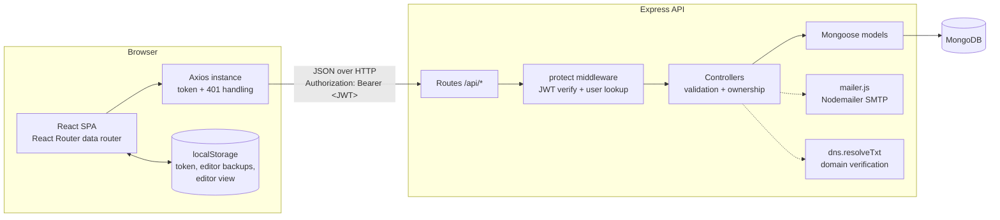
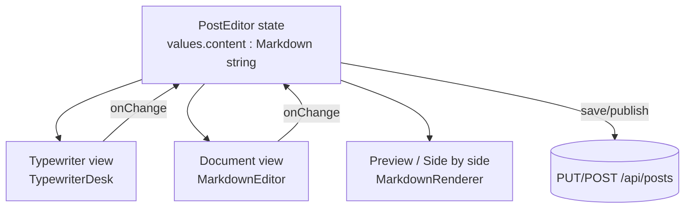
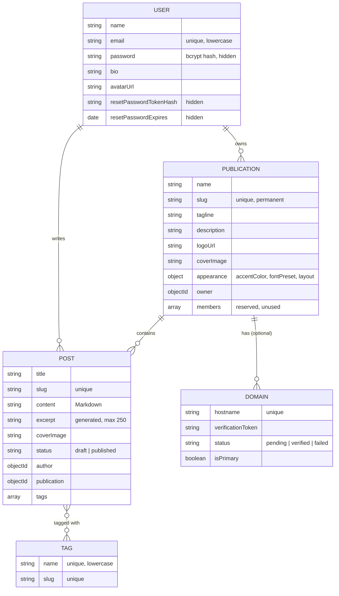
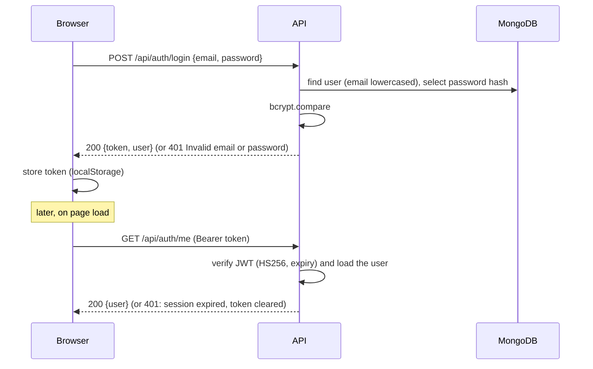

# DevPress: Architecture

How the parts of DevPress fit together. For setup see the [README](../README.md); for security details see [SECURITY.md](SECURITY.md).

## 1. Overview

DevPress is a single-page React application talking to a JSON REST API built with Express, which stores data in MongoDB through Mongoose.



The client is served by Vite in development (`:5173`) and as static files (`client/dist`) in production. The API listens on `PORT` (default `5001`) and only accepts browser requests from `CLIENT_URL` (CORS).

## 2. Three experiences in one client

| Experience | URLs | Frame | Purpose |
|---|---|---|---|
| Platform | `/`, `/explore`, `/tags`, `/tag/:slug`, `/about`, `/login`, `/register`, `/forgot-password`, `/reset-password`, `/profile/:id`, `/settings`, `/privacy`, `/terms` | `AppShell` (top bar, drawer, footer) | Accounts and discovery |
| Workspace | `/publications`, `/publications/new`, `/publications/:slug/{dashboard,articles,write,editor/:id,analytics,appearance,domain,settings}` | `AppShell` + `WorkspaceLayout` (sidebar) | Writing and managing a publication (owner only) |
| Publication website | `/p/:slug`, `/p/:slug/about`, `/p/:slug/:postSlug` | `PublicationSite` (own header and footer, publication appearance) | What readers see |

Legacy routes redirect: `/dashboard` → `/publications`, `/post/:slug` → the article's publication URL, `/editor/:id` → the article's workspace editor.

`App.jsx` also checks the hostname with `hostMode()` (`utils/publication.js`). On `localhost`, or when no platform domain is configured, everything is the platform. With `VITE_PLATFORM_DOMAIN` set, `<address>.<domain>` and verified custom domains render that publication's website at the root of the host.

## 3. Frontend

### 3.1 Structure

```
client/src/
  main.jsx            createBrowserRouter (data router, enables navigation blocking) + error page
  App.jsx             routes for the three experiences
  api/axios.js        Axios instance: base URL from VITE_API_URL, token header, 401 → session expired
  context/            AuthContext: user, token, status (loading | guest | authenticated), login/register/logout
  hooks/              useAuth, useRequest (data fetching with abort and reload), useReveal (landing entrances)
  components/
    common/           Icon, Avatar, AuthForm, ConfirmDialog, EmptyState, PageMeta, CoverImage, spinners
    layout/           AppShell, Navbar, MainNav, MobileNav, Footer, ProtectedRoute
    workspace/        WorkspaceLayout (sidebar, publication switcher, outlet context)
    publication/      PublicationSite, PublicationMark, PublicationPreview, IdentityFields, AppearanceFields, SiteLink
    editor/           MarkdownEditor (toolbar), TagInput, typewriter/TypewriterDesk + keyLayout
    post/             PostCard, PostList, MarkdownRenderer, remarkDevpressFormat, DeletePostDialog
    landing/          TypewriterScene (SVG illustration)
  pages/              platform pages, pages/workspace/*, pages/pub/*
  styles/             tokens.css, base, layout, components, pages, platform, landing, typewriter, publication
  utils/              validation, apiError, markdownFormat, richFormat, typewriterPages, publication,
                      draftBackup, safeRedirect, lazyWithReload, format
  test/               fakeServer (Axios adapter), renderWithAuth
```

### 3.2 State and data

- **Session:** `AuthContext` restores the session at start-up by calling `GET /api/auth/me` with the stored token (`localStorage` key `hashnode_token`). The Axios response interceptor treats any HTTP 401 on an authenticated request as an expired session: it clears the token and the app sends the user to Log in with a message.
- **Server data:** pages fetch with `useRequest` (abortable, reloadable). There is no global data store; each page owns its data.
- **Workspace context:** `WorkspaceLayout` loads the publication once (`/api/publications/:slug/manage`, owner only) and passes it to the workspace pages through the router outlet context.
- **Local storage:** the token, per-article editor backups (`devpress_editor_backup:<user>:<article>`), and the preferred editor view (`devpress:editor-surface`).

### 3.3 The article editor

`pages/PostEditor.jsx` owns the article form state (`title`, `content`, `coverImage`, `tags`) and every persistence path: save, publish, update, unpublish, delete, the local backup, and the leave-page guard (`useBlocker` plus `beforeunload`). Four views show the **same** `content` string:



- **Typewriter** (`components/editor/typewriter/TypewriterDesk.jsx`): a scene built from three transparent images (body, carriage, paper) plus CSS. Keystrokes go into a real, transparent `<textarea>`, so typing, pasting, undo and screen readers behave normally. Everything visible is drawn from the content: `paginate()` (`utils/typewriterPages.js`) is a pure function that cuts the Markdown into rows and pages and **never changes it** (tests prove `joinPages(paginate(x)) === x`). Key presses, the carriage, page flights and the stack are animated with the Web Animations API and catch up with large pastes without blocking input. Reduced motion and background tabs place pages directly on the stack.
- **Document** (`components/editor/MarkdownEditor.jsx`): a native textarea that grows with the article, and a grouped toolbar. Toolbar actions are pure functions in `utils/markdownFormat.js` that return one text replacement, applied through the browser's edit command so undo keeps working. `formatState()` reports the formats active at the cursor.
- **Rendering** (`components/post/MarkdownRenderer.jsx`): `react-markdown` with `remark-gfm` and `remarkDevpressFormat`, `react-syntax-highlighter` for code blocks, and safe links and images. The same renderer is used for Preview, Side by side and published articles.

### 3.4 Safe formatting extensions

Markdown has no underline, colour, font or alignment, so DevPress accepts a fixed set of exact tags (defined in `utils/richFormat.js`):

```
<u>…</u>   <mark>…</mark>   <mark data-highlight="green|blue|pink">…</mark>
<span data-color="rust|amber|forest|ocean|plum|slate">…</span>
<span data-font="serif|sans|mono">…</span>   <span data-size="small|large|xlarge">…</span>
<div data-align="center|right">  …blocks…  </div>
```

`remarkDevpressFormat` matches these as exact strings and pairs opening and closing tags like brackets. Matched pairs become elements; **every other piece of HTML is turned into plain text**. No HTML parser is involved, so scripts, styles, event handlers and unknown attributes can never render.

## 4. Backend

### 4.1 Structure

```
server/
  server.js        Express app: CORS, JSON parser, /api/health, routes, 404 + error handler, startup
  config/db.js     mongoose.connect(MONGO_URI); exits if missing or unreachable
  routes/          URL → controller mapping, protect middleware where login is needed
  controllers/     request validation, ownership checks, model calls, JSON responses
  middleware/      authMiddleware.protect (JWT), errorMiddleware (notFound, errorHandler)
  models/          Mongoose schemas
  utils/           generateToken, generateSlug, generateExcerpt, resolveTags, publicationRules,
                   isValidEmail, isHttpUrl, toUserResponse, userLimits, mailer
```

Controllers are `async` functions; with Express 5, a thrown error goes straight to `errorHandler`, which sends `{ message }` with the status set by the controller (stack traces only outside production).

### 4.2 API

| Method | Route | Access |
|---|---|---|
| GET | `/api/health` | Public |
| POST | `/api/auth/register`, `/api/auth/login` | Public |
| POST | `/api/auth/forgot-password`, `/api/auth/reset-password` | Public |
| GET | `/api/auth/me` | Logged in |
| GET | `/api/posts?search=&tag=` | Public (published only) |
| GET | `/api/posts/:slug` | Public (published only) |
| GET | `/api/posts/mine` | Logged in (own articles, drafts included) |
| GET | `/api/posts/id/:id` | Author only (editor) |
| POST | `/api/posts` | Logged in; the target publication must be owned by the user |
| PUT, DELETE | `/api/posts/:id` | Author only |
| GET | `/api/tags`, `/api/tags/:slug/posts` | Public |
| GET | `/api/users/:id` | Public profile |
| PUT | `/api/users/me` | Logged in |
| GET | `/api/publications` | Public list |
| GET | `/api/publications/check-slug?slug=` | Public |
| GET | `/api/publications/mine` | Logged in |
| POST | `/api/publications` | Logged in |
| GET | `/api/publications/resolve-host?host=`, `/api/publications/domain-config` | Public (custom-domain routing) |
| GET | `/api/publications/:slug`, `/:slug/posts`, `/:slug/posts/:postSlug` | Public (published articles only) |
| GET | `/api/publications/:slug/manage`, `/:slug/manage/posts` | Owner |
| PUT | `/api/publications/:slug` | Owner (address cannot change) |
| GET, POST | `/api/publications/:slug/domains` | Owner |
| POST | `/api/publications/:slug/domains/:domainId/verify` | Owner |
| DELETE | `/api/publications/:slug/domains/:domainId` | Owner |

### 4.3 Data model



All schemas have `createdAt` and `updatedAt` timestamps. Images are stored as URLs; no binary data is kept in MongoDB.

### 4.4 Rules enforced on the server

- Publication fields: name ≤ 60, tagline ≤ 80, description ≤ 300. Address: 3–40 characters, lowercase letters, numbers and single hyphens (not at the start or end), not a reserved word.
- Users: name ≤ 50, bio ≤ 200; password ≥ 6 characters.
- Articles: up to 10 tags, each ≤ 30 characters; new tags are created on save. The excerpt is generated from the Markdown with formatting removed.
- Appearance values must come from the curated lists (`utils/publicationRules.js`).

## 5. Key data flows

### Log in and restore a session



### Publish an article

1. The editor validates the title and content, then sends `PUT /api/posts/:id` with `status: 'published'` (or `POST /api/posts` with the publication id for a new article).
2. `protect` identifies the user; the controller checks the user is the author and owns the publication, resolves tags, regenerates the excerpt and saves. The article's slug is set once, when it is created, and is deliberately not changed when the title changes, so links keep working.
3. The publication website reads it through `GET /api/publications/:slug/posts/:postSlug`, which only returns published articles.

### Password reset

`forgot-password` answers the same way for every email, then, if the account exists, stores a SHA-256 hash of a random token with a 30-minute expiry and emails a link (`/reset-password#token=…`). `reset-password` hashes the submitted token, checks expiry, sets the new password and deletes the token. Details: [SECURITY.md](SECURITY.md#password-reset).

## 6. Build and runtime

| | Development | Production |
|---|---|---|
| Client | `npm run dev` (Vite, :5173) | `npm run build` → `client/dist` (static files; host must rewrite all paths to `index.html`) |
| API | `npm run dev` (nodemon) | `npm start` with `NODE_ENV=production` |
| Database | MongoDB Atlas or local | MongoDB Atlas |

Pages that need heavy libraries (the Markdown renderer) are loaded lazily with `lazyWithReload`, which reloads once if a deployed bundle has been replaced.
